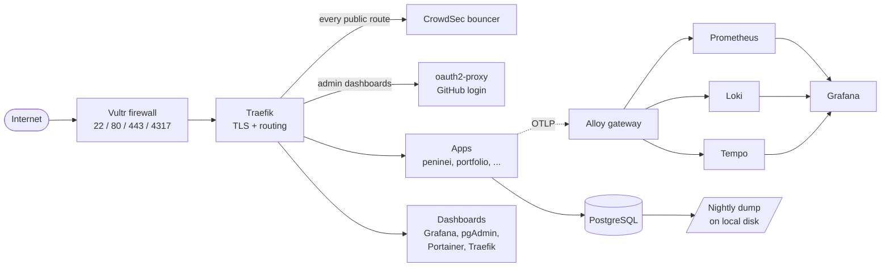

# Private VPS - Personal Infrastructure & App Platform

A single Vultr VPS (DNS on Namecheap) that hosts my side projects, run like a small production platform: Docker Swarm,
Traefik for routing and TLS, a full observability pipeline, perimeter security, and automated backups and housekeeping.
It started as one `docker compose` file behind Nginx Proxy Manager with no monitoring and secrets in `.env` files, and
was migrated stack by stack.

## The problem

Running several unrelated apps (a scraper/API/PWA, a portfolio site, more to come) on one box, solo, with no ops team, meant:

- **No visibility.** If something broke I would not be alerted, and I couldn't diagnose it properly.
- **No isolation or repeatability.** One `docker-compose.yml` per project, hand-run over SSH; no consistent way to roll
  out a new service, roll back a bad deploy, or reason about what was actually running.
- **Secrets in plaintext.** Database URLs and API keys lived in `.env` files on disk.
- **No perimeter security.** Anything exposed was exposed directly, with no bot/abuse mitigation and no central auth in
  front of admin panels (pgAdmin, Portainer, etc.).
- **Adding a new project was expensive.** Every new app meant hand-writing Traefik labels, wiring networks, and
  re-deriving the same Swarm boilerplate.

## System overview



Everything runs as stacks on a **single-node Docker Swarm**. Services join only the shared overlay networks they need:
`proxy-network` (anything Traefik routes to), `database-network` (Postgres), `monitoring-network` (telemetry). Public
routes carry the `crowdsec-bouncer@swarm` middleware; admin dashboards carry `sso@swarm`, which is CrowdSec followed by a
GitHub login restricted to one email. Secrets are Docker Swarm secrets, never files in the repo.

### Platform stacks

Each folder has its own README: what it is, how to deploy it, how to operate it.

| Stack                                                 | Purpose                                                                                                      |
| ----------------------------------------------------- | ------------------------------------------------------------------------------------------------------------ |
| [`traefik`](infrastructure/traefik/README.md)         | Edge reverse proxy and automatic TLS (Let's Encrypt); replaced Nginx Proxy Manager                           |
| [`auth`](infrastructure/auth/README.md)               | oauth2-proxy + GitHub forward-auth (`sso@swarm`) in front of every dashboard; one allowed email, no database |
| [`crowdsec`](infrastructure/crowdsec/README.md)       | Intrusion detection + a Traefik bouncer that blocks abusive IPs                                              |
| [`monitoring`](infrastructure/monitoring/README.md)   | Grafana, Prometheus, Loki, Tempo, Alloy (OTLP gateway), cAdvisor, node-exporter, postgres-exporter           |
| [`postgres`](infrastructure/postgres/README.md)       | Shared PostgreSQL instance + pgAdmin                                                                         |
| [`portainer`](infrastructure/portainer/README.md)     | Swarm ops UI                                                                                                 |
| [`registry`](infrastructure/registry/README.md)       | Private Docker image registry (Zot) with htpasswd auth and tag retention, so images are built off the VPS    |
| [`backup`](infrastructure/backup/README.md)           | Nightly Postgres dump to local disk (newest 2 kept)                                                          |
| [`maintenance`](infrastructure/maintenance/README.md) | Weekly prune of images, containers, stale volumes and logs                                                   |

### Projects running on it

- **[Peninei Halacha](peninei/README.md)** - a daily-halacha (Jewish law) scraper from an existing Hebrew website: a
  scraper, an API, and an offline-capable PWA (Express/Prisma backend, Vite/React frontend). The first real app migrated
  onto the platform end to end: a Swarm stack with single-domain path-based routing (frontend and API share one origin,
  no CORS), OpenTelemetry metrics/logs into Grafana, and a real production bug (a timezone-dependent date bug) found and
  fixed along the way. Its simplicity let me test the infrastructure and validate the observability pipeline before
  trusting it with something more complex.
- **[Observability test app](infrastructure/monitoring/test-app/README.md)** - a disposable multi-service Flask demo
  built to validate the OTLP -> Alloy -> Prometheus/Loki/Tempo -> Grafana pipeline _before_ trusting it with a real app.
  Its telemetry code became the reference the peninei backend was ported from.
- **[Hello](hello/README.md)** - a one-page site used to prove the build-on-PC -> private registry -> Portainer deploy loop.
- **[Portfolio](portfolio/README.md)** - personal site (Eleventy + nginx), a writing class portfolio. Image, stack and CI are ready; deploy via Portainer.

## Repository layout

```
.
├── README.md                    you are here
├── docs/
│   ├── deployment.md            bootstrap a VPS, DNS, secrets list, deploy order, rollback
│   ├── operations.md            host security, backups, housekeeping, recovery notes
│   ├── ci-cd.md                 plan: GitHub Actions -> registry -> Portainer
│   └── roadmap.md               detailed roadmap and alert ideas
├── infrastructure/              the platform: one folder per stack, each with stack.yml + README
│   ├── traefik/  auth/  crowdsec/  monitoring/  postgres/  portainer/  registry/
│   ├── backup/  maintenance/    systemd-timer jobs
│   └── install-host-jobs.sh     installs the two timers on the VPS
├── hello/                       app: tiny static page (Dockerfile + stack.yml for Portainer)
├── peninei/                     app: scraper + API + PWA (stack.yml, Dockerfiles)
└── portfolio/                   app: static site
```

Layout rule: `infrastructure/<stack>/stack.yml` for platform pieces, `<app>/stack.yml` for apps.

## Documentation

| I want to...                                          | Read                                     |
| ----------------------------------------------------- | ---------------------------------------- |
| stand the whole thing up, or redeploy one stack       | [docs/deployment.md](docs/deployment.md) |
| know how the server is secured, backed up and cleaned | [docs/operations.md](docs/operations.md) |
| see what's planned                                    | [docs/roadmap.md](docs/roadmap.md)       |
| work on one stack                                     | the README in its folder (table above)   |

## What I learned

<!-- To fill in. -->

## Roadmap

Detailed list: [docs/roadmap.md](docs/roadmap.md).

**Done so far:** Swarm + Traefik platform; observability pipeline; CrowdSec; SSO for dashboards; host hardening (cloud
firewall, key-only SSH, fail2ban, automatic security patches); nightly local Postgres backup; weekly cleanup job; private
registry (Zot); GitHub Actions builds (per-folder `latest` + manual dated releases); Grafana email alerts as code; the
observability stack and portfolio shipped as CI-built images.

**Next**

- Docker hardening: pin image versions, a socket proxy for Traefik, drop container capabilities, scan images
- Move peninei onto registry images (CI phase 3) so nothing is built on the VPS, and deploy the portfolio
- Fix the remaining peninei telemetry gaps (traces, logs landing in Loki)
- Alerts for what is still unmonitored: stale backups, peninei app/data freshness, CrowdSec spikes
- Proper staging vs production environments

**Later**

- Off-box encrypted backups, telemetry/system snapshots, and a restore drill
- Put the portfolio back online and host more personal projects on the platform, with a landing page
- Switch peninei's AI step from OpenAI to Claude
- Maybe: Coolify as a deployment dashboard (probably too heavy for this VPS)
